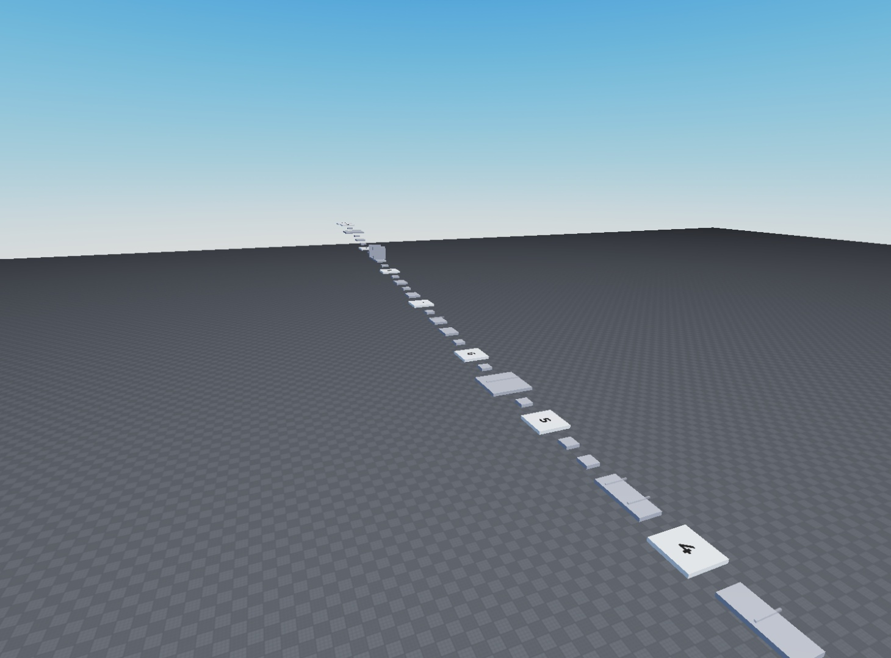
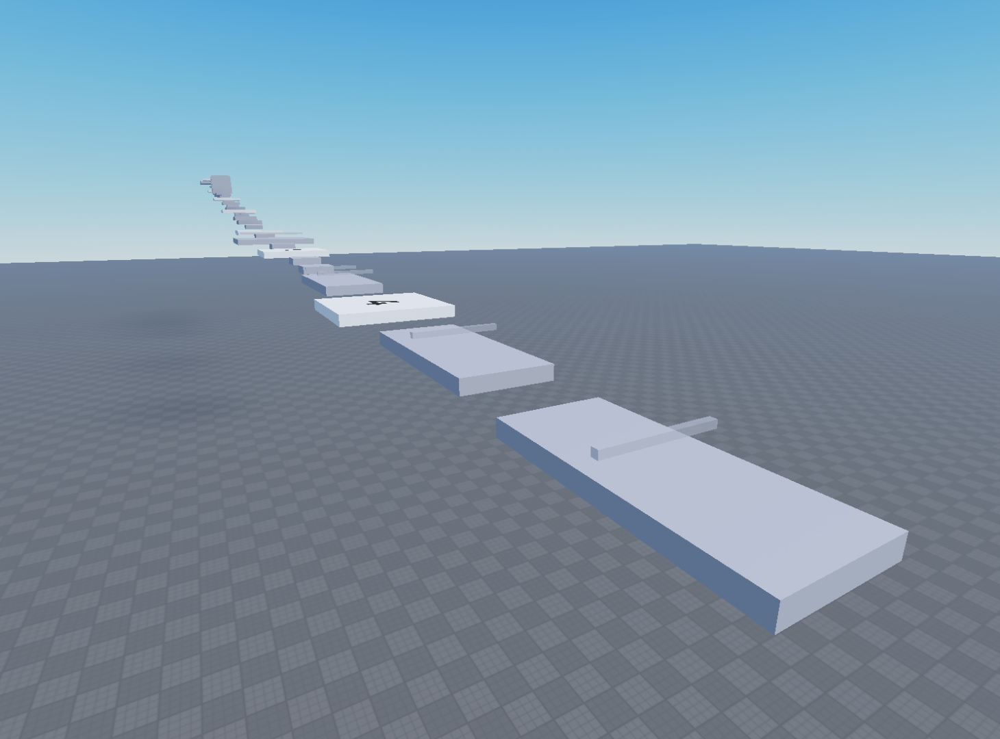
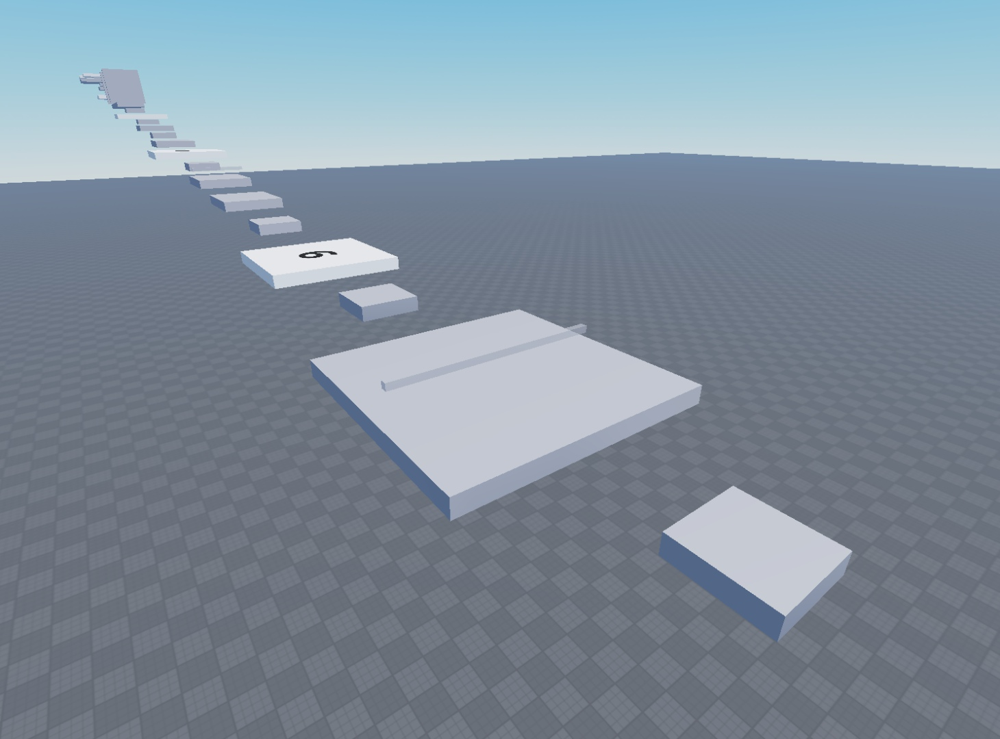
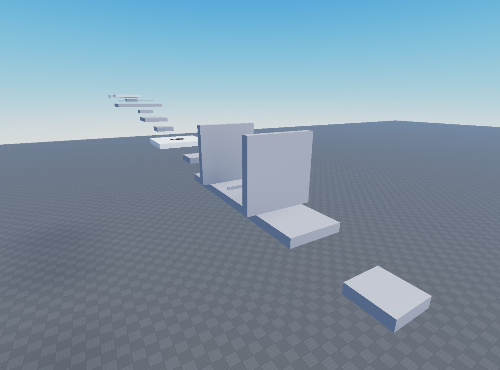
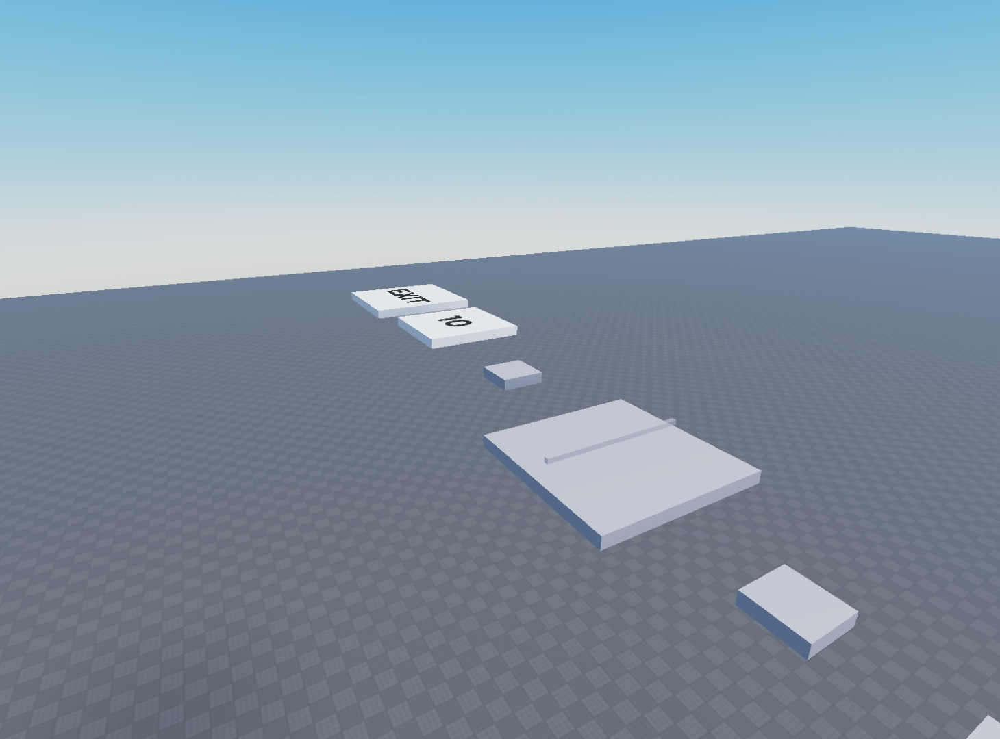

# MyObby — 실험실 탈출 오비 (Roblox)

실험실에 갇힌 플레이어가 레이저 복도, 회전 레이저, 화물 컨베이어, 보안문을 지나 탈출하는 **로블록스 오비(장애물 코스) 게임**입니다.
기획 → 그레이박스 → 시스템 → 비주얼 순서로 개발하며, 진행 과정을 이 저장소에 기록합니다.

> **현재 단계: 1단계 그레이박스 프로토타입**
> 재미 검증이 목적이라 색·재질·장식 없이 형태와 동작만 만들었습니다.

## 스크린샷 (그레이박스)



| 레이저 복도 (4–5) | 회전 레이저 (6) |
|---|---|
|  |  |
| **보안문 (9)** | **마지막 구간 → EXIT (10)** |
|  |  |

> 편집 모드 화면이라 회전 막대·움직이는 발판·문은 멈춘 상태로 찍혔습니다. 반투명한 얇은 막대가 닿으면 죽는 레이저입니다.

## 플레이 구성

| 구간 | 스테이지 | 장애물 | 핵심 학습 포인트 |
|---|---|---|---|
| 감방 | 1–3 | 기본 점프 | 조작 익히기 |
| 레이저 복도 | 4–5 | 낮은 레이저 바 넘기 | 닿으면 죽는 파트 인지 |
| 실험실 | 6 | 회전 레이저 막대 | 타이밍 점프 |
| 화물 창고 | 7–8 | 좌우로 움직이는 발판 | 움직이는 발판 탑승 |
| 보안문 | 9 | 3초마다 번갈아 열리는 문 2개 + 레이저 | 기다림과 타이밍 |
| 탈출 | 10 → EXIT | 위 장애물 종합 | 마무리 도전 |

- 발판 간격은 3 → 6스터드, 높이차는 0 → 1.75스터드로 **점진적으로** 늘어납니다 (기본 점프 최대 약 8.7스터드 → 모바일에서도 클리어 가능).
- 떨어지거나 레이저에 닿으면 **마지막 체크포인트**에서 1초 만에 리스폰됩니다.
- 리더보드에 현재 스테이지가 표시되고, 탈출하면 `Stage 11` + "탈출 성공!" 메시지가 뜹니다.

## 기술 포인트

- **서버 권한 판정** — 스테이지 진행은 서버에서만 처리하고, *바로 다음 체크포인트만* 인정해 순간이동 핵으로 건너뛰기를 막습니다.
- **태그 기반 장애물 시스템** — `CollectionService` 태그(`KillPart`, `Spinner`, `Mover`, `TimedDoor`)와 속성(Attribute)만으로 장애물을 추가·조정할 수 있습니다. 스크립트를 고치지 않고 레벨 디자인을 반복할 수 있게 하기 위함입니다.
- **물리 제약 기반 움직임** — 움직이는 발판은 `PrismaticConstraint`, 회전 막대는 `HingeConstraint`로 구동해 캐릭터가 발판에 자연스럽게 실려 가도록 했습니다.
- **서버 시간 동기화** — 보안문은 `workspace:GetServerTimeNow()` 기준 하나의 시계로 돌아가 모든 플레이어에게 같은 박자로 보입니다.
- **역할별 스크립트 분리 + `--!strict`** — 리더보드 / 체크포인트 / 리스폰 / 장애물 / 골인 / UI를 각각 나눴습니다.

## 프로젝트 구조

```
src/
├─ ServerScriptService/
│  ├─ Leaderstats.server.luau   리더보드 Stage 값 생성
│  ├─ Checkpoints.server.luau   체크포인트 진행 판정
│  ├─ Respawn.server.luau       낙사 처리 + 마지막 체크포인트 리스폰
│  ├─ Hazards.server.luau       태그 기반 장애물 구동
│  └─ Finish.server.luau        골인 판정 → 클라이언트에 알림
└─ StarterPlayer/StarterPlayerScripts/
   └─ EscapeMessage.client.luau "탈출 성공!" 화면 표시
```

Studio 안의 배치:

```
Workspace/Stages/Stage01~10      스테이지별 Model
Workspace/Checkpoints/1~11       체크포인트 (11 = EXIT, 속성 IsFinish)
Workspace/KillZone               낙사 판정 바닥
ReplicatedStorage/Remotes/Escaped  서버 → 클라이언트 탈출 알림
```

## 로드맵

- [x] 1단계: 그레이박스 — 10스테이지, 체크포인트·리스폰·리더보드, 테마 장애물
- [ ] 2단계: 시스템 — 진행 저장(DataStore), 스테이지 스킵 상품, 보상형 광고
- [ ] 3단계: 비주얼 — 실험실 테마 재질·조명·사운드, 썸네일/아이콘

## 개발 방식

Roblox Studio를 MCP로 연결한 [Claude Code](https://claude.com/claude-code)와 함께 개발합니다.
기획·검증·플레이테스트 결과는 날짜별로 [NOTES.md](NOTES.md)에 기록합니다.

Claude Code와 OpenAI Codex를 번갈아 사용합니다. 두 AI가 이전 대화 없이도 이어서 작업할 수 있도록 문서를 나눠 둡니다.

- [AGENTS.md](AGENTS.md): 공통 개발 지침
- [HANDOFF.md](HANDOFF.md): 현재 상태 인수인계
- 커밋 메시지 앞의 `[Claude]` / `[Codex]`: 작업한 AI 표시
