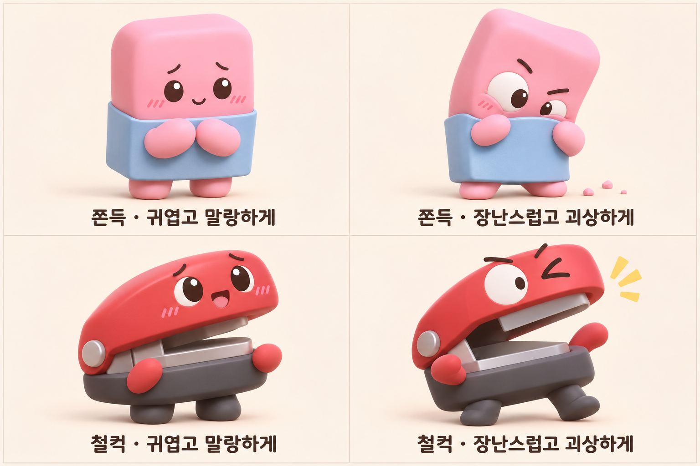
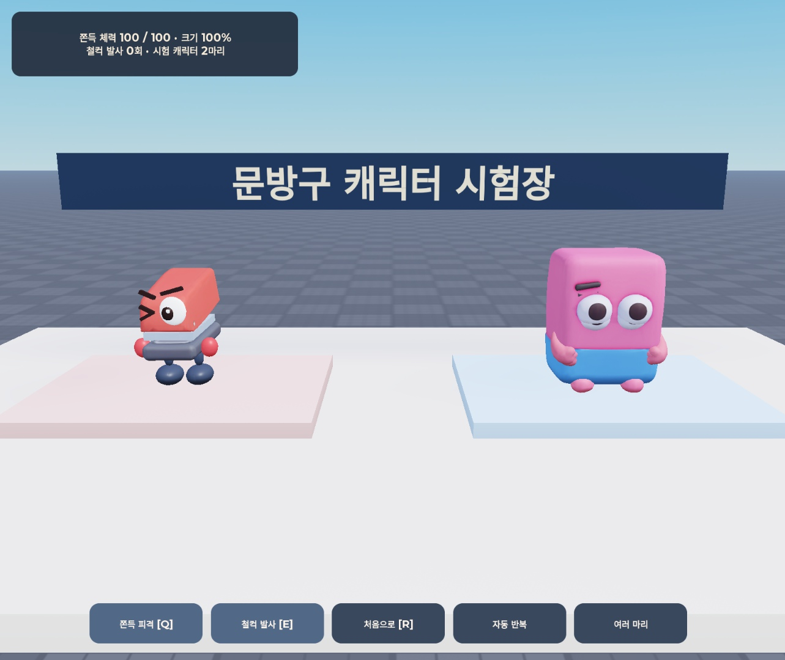
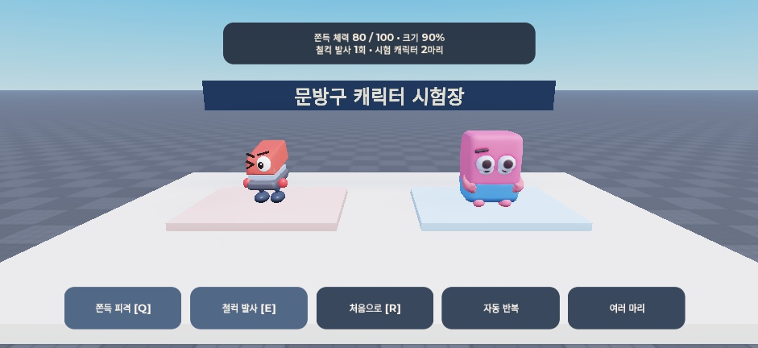
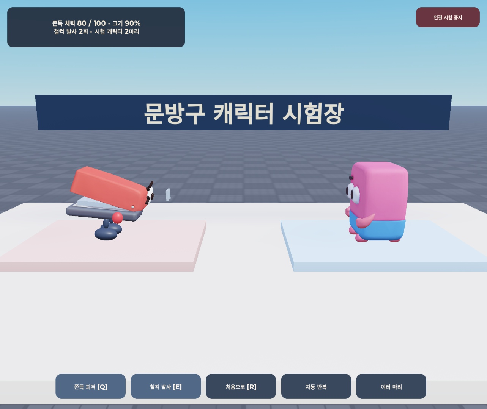
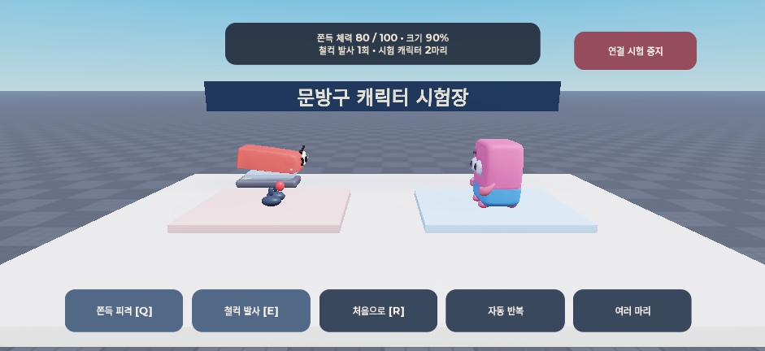
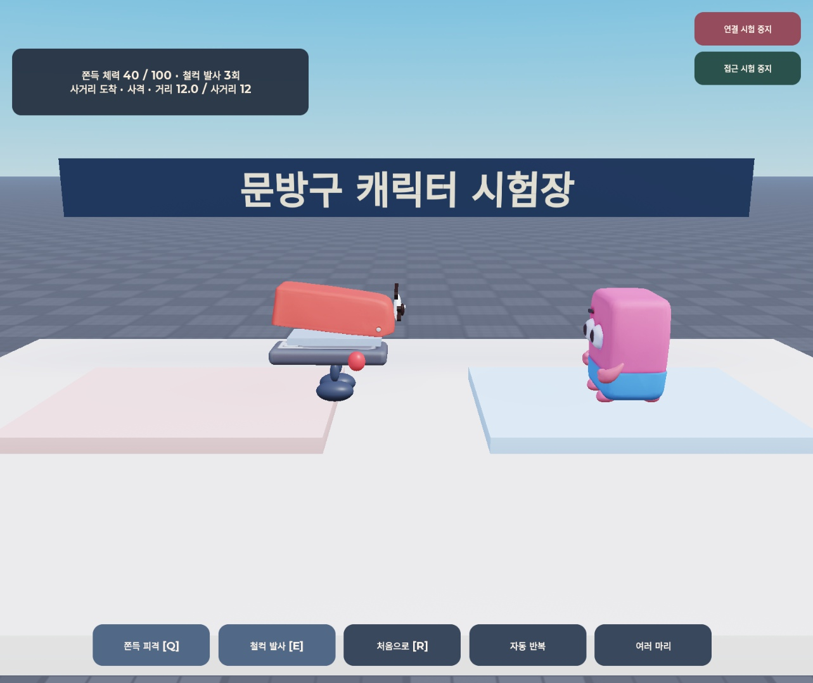

# 새 Roblox 게임 기획·논의 기록

작성일 2026-11-18 · 작성 AI Codex · 상태 구상 논의 중

## 1. 다음 AI가 먼저 읽을 내용

사용자는 기존 로봇 고물상 타이쿤의 마무리를 Claude Code에게 맡기고, Codex와 새 게임을 구상하려 한다. 이 문서는 두 AI가 새 게임의 맥락과 미결정을 공유하기 위한 별도 기획서다. 현재 작업물은 이 문서·콘셉트 이미지와 새 Studio의 캐릭터 시험장이다. 최신 구현·검증은 16절에 있다.

새 게임은 별도 Studio의 `문방구 전쟁`, Place ID `123176209315432`, Universe ID `10777479934`로 저장됐다. 현재 폴더 `C:\RobloxProjects\MyObby`와 Place ID `77293997616106`은 기존 로봇 고물상 프로젝트다. 새 게임의 임시 시험 소스는 기존 `src/`와 구분되는 `new-game-prototype/`에 보관하며, 정식 폴더·저장소 분리는 미정이다. 초기 시험 기록은 14절, 연결 시험은 15절, 최신 접근·사거리 시험 상태는 16절에 있다.

사용자는 기존 문서의 수정을 금지했다. 새 게임에 관한 후속 논의는 이 파일을 갱신한다. 실제 구현은 아래 미결정을 사용자와 확정한 뒤 시작한다.

## 2. 사용자가 제시한 방향

아래 내용은 사용자가 직접 말한 방향이다. 수치와 세부 규칙의 승인을 의미하지 않는다.

- 클래시오브클랜 같은 기지 공격·방어의 느낌을 원한다. 테마·이름·캐릭터·맵은 새롭게 만든다.
- 매 판 모든 플레이어에게 같은 금액을 지급한다.
- 그 돈을 공격과 수비에 얼마나 배분할지는 플레이어가 고른다.
- 수비 집중, 공격 집중, 균형 투자가 서로 다른 전략으로 성립해야 한다.
- 상대와 동시에 공격하는 방식을 선호한다.
- 기지가 연결된 전장과 각자 상대 기지를 공략하는 전장을 모두 모드로 제공하는 방향을 선호한다. 모드에 따라 유닛 활용에 차이가 생기기를 기대한다.
- 두 모드에서 공통 유닛을 사용하고, 플레이어가 전투 중 병력 투입과 스킬을 직접 조작하는 추천 방향을 승인했다. 유닛은 투입 후 자동 이동·공격하는 구체안을 아래에 정리한다.
- 테마는 문방구 방향을 선택했다. 문구와 작은 장난감에서 캐릭터와 전장 소재를 발전시킨다. 캐릭터의 정확한 외형·성격·이름과 게임명은 아직 정하지 않았다.
- 비교 이미지에서는 장난스럽고 조금 괴상한 쪽을 선호했다. 쫀득은 피격할수록 작아지고, 철컥은 발사 소리에 놀라 뒤로 밀리는 특징을 제시했다. 지금은 콘셉트 세부 확정보다 실제 게임에서 외형·동작을 구현할 수 있는지 확인하는 일이 우선이다(13절).
- 아직 큰 개념만 잡힌 단계이며, 대화하면서 구체화하고 싶어 한다.

사용자가 새로 제기한 고민은 다음과 같다.

1. 플레이 인원이 적거나 상대가 없을 때 어떻게 진행할 것인가.
2. 서로 수비에만 집중하면 교전이 줄고 지루해지지 않을까.
3. 여러 명이 접속했을 때 누구와 누구를 매칭할 것인가.

전투 중 직접 조작은 병력 투입과 스킬 사용으로 방향을 정했다. 투입 가능 구역, 스킬 효과·횟수, 카메라 방식은 다음 세부 결정이다.

## 3. Codex가 제안하는 첫 시험 버전

**1대1 동시 공방을 기본으로 하고, 여러 쌍의 경기를 동시에 진행하는 방식**을 먼저 시험한다. 아래는 사용자 확인 전 제안이다.

게임 전체 방향은 두 전투 모드와 공통 유닛, 병력 투입·스킬 직접 조작이다(7절). Codex는 연결 전장을 먼저 시험하는 순서를 제안한다. 첫 모드의 최종 선택과 수치·테마는 미정이다.

| 항목 | 시험용 제안 | 확인할 이유 |
|---|---|---|
| 경기 인원 | 한 경기 1대1 | 공격 대상과 승패를 이해하기 쉬움 |
| 예산 | 매 라운드 각 1,000 | 공격·수비 배분을 비교하기 위한 임시 단위 |
| 기본 지급 | 양쪽에 같은 본부와 소규모 기본 공격대 | 수비에 전액 투자해도 공격 수단이 존재 |
| 준비 시간 | 45초 | 병력 구매와 방어 배치 |
| 전투 시간 | 최대 90초 | 수비 대치가 계속되는 시간 제한 |
| 전투 중 조작 | 병력 투입 위치·시점과 공통 스킬 1개 | 전투를 지켜보면서 판단할 여지를 줌 |
| 기본 전투 처리 | 투입된 병력은 자동 이동·자동 공격 | 작은 화면의 조작량을 줄임 |
| 다음 라운드 | 예산·건물·병력·소모 스킬 초기화 | 이전 승패가 다음 판 전투력 격차로 이어지는지 방지 |
| 장기 성장 | 우선 전적·외형·칭호 후보 | 판마다 같은 예산이라는 방향과 맞는 성장 방식 검토 |

1,000골드와 45초·90초는 밸런스가 검증된 수치가 아니다. 첫 플레이 결과로 조정한다. 단판인지, 같은 상대와 여러 라운드 겨루는지는 별도 결정한다.

흐름은 매칭 → 동시 준비 → 양측 배치 확정 → 동시 전투 → 결과 확인 → 재대결 또는 대기열 복귀다. 양쪽의 선택이 확정된 뒤 상대 배치를 공개하면 마지막 순간 상대를 보고 정답으로 바꾸는 문제를 줄일 수 있다. 정찰 정보의 공개 범위는 논의가 필요하다.

## 4. 수비에만 투자하는 전략을 어떻게 다룰까

### 기본 공격대와 자유 예산을 함께 주는 안

모두 같은 소규모 공격대를 무료로 받고, 추가 예산 1,000을 자유롭게 배분한다. 기본 공격대는 전투 시작 뒤 일정 시간 내에 양쪽에서 자동 출발하는 안을 제안한다. 추가 구매 병력의 투입은 플레이어가 결정한다.

이 경우 수비 1,000 / 추가 공격 0도 가능하다. 상대의 큰 공격을 버티는 동안 기본 공격대가 상대의 약한 기지를 공략할 수 있다. 공격 집중은 상대를 빠르게 무너뜨리는 대신 자기 본부가 기본 공격대에도 위험해진다.

무료 공격대의 수와 성능 역시 양쪽에 동일하다. 예산 배분 화면에는 무료 지급분과 내가 투자한 금액이 각각 보이게 한다.

### 상대 본부에 준 피해를 중심으로 승패를 정하는 안

권장하는 첫 시험 규칙은 다음과 같다.

1. 상대 본부를 먼저 파괴하면 승리한다. 같은 서버 판정 시점에 양쪽 본부가 함께 파괴되면 무승부다.
2. 제한 시간이 끝나면 상대 본부에 준 누적 피해율이 높은 쪽이 승리한다. 첫 버전은 본부 최대 체력을 동일하게 하고 회복을 제외해 비교를 단순하게 한다.
3. 피해율까지 같으면 무승부다.
4. 양쪽의 남은 공격 병력·투입 대기 병력이 모두 없고 이후 공격이 생길 방법도 없다면 전투를 조기 종료한다.

기본 공격대가 강한 수비에 모두 막히면 여전히 무승부가 날 수 있다. 무료 병력을 주는 것만으로 수비 대치 문제가 해결됐다고 판단해서는 안 된다.

### 수비 대치가 반복되면 비교할 대안

| 대안 | 기대 효과 | 함께 생기는 변화 |
|---|---|---|
| 중앙 거점 점령을 동률 판정에 사용 | 본부 피해가 같아도 병력을 밖으로 보내는 이유가 생김 | 병력이 두 기지 사이 같은 전장에서 싸우는 구조가 필요 |
| 후반 공성 강화 | 시간이 지나면 공격대가 단단한 수비를 공략하기 쉬워짐 | 버티는 전략이 급격히 약해질 수 있어 적용 시점 검증 필요 |
| 공성 병력과 돌격 병력의 상성 | 수비 시설에 강한 병력, 그 병력에 강한 기동 병력을 조합 | 어떤 조합 하나가 모든 상황에 강해지는지 확인 필요 |
| 공격 최소 투자액 지정 | 공격 병력 부족을 직접 방지 | 배분 자유도가 줄어들므로 사용자 선택 필요 |

첫 시험은 기본 공격대·시간 제한·본부 피해 판정으로 시작하는 안을 권한다. 수비 대치가 반복되면 중앙 거점 안을 사용자와 비교한다. 최소 공격 투자액은 아직 채택하지 않았다.

수비 전략의 승률뿐 아니라 교전이 없는 시간, 무승부 비율, 공격 집중 전략의 반격 가능성을 함께 본다. 공격 집중·수비 집중·균형 중 하나가 항상 우세하다면 가격·상성·배치 조건을 조정한다.

## 5. 상대가 없거나 인원이 홀수일 때

| 대기 인원 | 제안하는 처리 |
|---|---|
| 1명 | 연습 상대와 바로 플레이하거나 사람 매칭을 기다릴 수 있게 함 |
| 2명 | 둘 다 준비됐으면 한 경기 생성 |
| 3명 | 두 명이 경기, 남은 한 명은 우선 대기 또는 연습 선택 |
| 4명 | 두 경기 동시 진행 |
| 5명 | 두 경기 동시 진행, 남은 한 명은 다음 매칭 우선 |
| 8명 | 시험 환경 예시로 네 경기 동시 진행 |

8명은 새 게임의 서버 정원 확정값이 아니다. 로봇 고물상의 정원을 새 게임 규칙으로 가져오지 않는다.

연습 상대는 봇임을 화면에 표시한다. 같은 예산과 허용 유닛을 사용하고, 수비형·공격형·균형형처럼 미리 정한 투자안을 고른다. 상대의 비공개 배치를 몰래 보고 대응하거나 예산을 초과하는 방식으로 난이도를 높이지 않는다.

봇 경기와 사람 상대 전적은 별도로 기록하는 안을 권한다. 봇전 보상을 PvP와 같게 할지는 미정이다. 사람이 왔다고 진행 중인 연습 경기를 갑자기 끊지 않고, 연습 종료 또는 플레이어의 명시적 선택 뒤에 매칭한다.

## 6. 여러 사람이 접속했을 때의 매칭

### 첫 시험은 서버 안의 준비된 플레이어끼리

공용 대기 공간에서 매칭 참가를 누르면 대기열에 들어간다. 먼저 기다린 사람부터 짝을 만들고, 이미 준비·전투 중인 사람은 새 매칭 대상에서 제외한다. 잠수 중인 사람은 준비 확인 기한이 지나면 대기열에서 빠진다.

매칭이 확정된 두 명에게는 다른 경기와 구분되는 경기 번호를 부여한다. 예산·타이머·건물·병력·결과가 그 경기에만 적용되어야 한다. 다른 경기의 유닛을 공격하거나 다른 경기 결과로 보상을 받는 경우를 검증한다.

첫 구현에서는 한 서버 안에 떨어진 전장 두 개 정도로 동시 경기 분리를 먼저 확인한다. 한 경기마다 플레이어를 다른 서버로 옮기는 구조와 여러 서버의 대기열을 합치는 구조는 접속 규모를 확인한 뒤 검토한다.

### 사람 수가 늘면 실력과 대기 시간을 함께 고려

| 기준 | 고려할 점 |
|---|---|
| 실력 | 승패를 바탕으로 비슷한 실력의 상대를 찾음 |
| 대기 시간 | 오래 기다리면 허용 실력 차이를 점차 넓힘 |
| 연결 상태 | 지연이 큰 상대와의 매칭은 조작 공정성을 함께 확인 |
| 신규 플레이어 | 연습 또는 신규 상대를 우선 제안하되 대기 시간도 표시 |
| 반복 상대 | 대안이 있으면 같은 상대와 연속 매칭을 줄임 |

공격 투자액이나 수비 투자액을 맞춰 매칭하면 상대 전략을 예측하고 대응하는 재미가 줄 수 있다. 투자안은 경기 준비 단계에서 결정하고, 매칭은 실력·대기 시간 중심으로 검토한다.

친구끼리 대결하는 기능은 일반 매칭과 구별해 검토한다. 친구전이 공개 경쟁 순위에 영향을 주는지는 미정이다.

### 두 모드의 대기 인원을 함께 고려

두 모드를 제공하면 총 접속자가 있어도 각 모드에서 상대가 부족할 수 있다. 초기에는 공용 대기열에서 참가자가 허용한 모드를 함께 기록하는 안을 제안한다. 선택지는 연결 전장만, 기지 공략만, 둘 다 가능이다.

먼저 기다린 참가자부터 허용 모드가 겹치는 상대를 찾는다. 양쪽 모두 두 모드가 가능하면 번갈아 배정하는 안을 검토한다. 특정 모드만 선택한 사람에게는 해당 모드를 유지하고, 대기가 길면 다른 모드도 허용할지 또는 봇 연습을 할지 선택하게 한다. 대기 시간이 길다는 이유로 선택하지 않은 모드에 자동 배정하지 않는다.

실력 비교는 초기에는 공통 기준으로 시작하는 안과 모드별로 나누는 안을 비교한다. 모드별 순위를 두는 경우에도 매칭 참가 화면에서 예상 대기 상태가 이해돼야 한다. 확정된 매칭 규칙은 아직 없다.

## 7. 두 전투 모드와 유닛 차별화

사용자는 아래 두 구조를 모두 모드로 제공하고 공통 유닛·투입/스킬 직접 조작을 사용하는 추천 방향을 승인했다. 아래 모드 이름은 설명을 위한 가칭이다. 각 모드의 승리 조건·투입 구역·스킬 세부 규칙·제작 순서는 미정이다.

| 구조 | 경기 모습 | 이후 설계에 미치는 영향 |
|---|---|---|
| 각자 상대 기지를 공략하는 두 전장 | 내 공격대는 상대 기지, 상대 공격대는 내 기지에서 동시 전투 | 화면 전환·방어 상황 알림이 중요하고, 중앙 거점은 바로 적용하기 어려움 |
| 양쪽 기지가 연결된 하나의 전장 | 병력이 중앙에서 만나거나 상대 기지로 진격 | 공성·가로막기·중앙 점령을 설계하기 쉬우며 이동 경로가 중요 |

### 연결 전장 모드의 재미 후보

병력이 중앙에서 만나므로 적 병력을 막아 세우기, 아군 뒤쪽 병력 보호, 옆길 우회, 전선 유지가 중요하다. 기지에 방어 시설을 짓는 투자와 밖에서 병력으로 막는 투자도 비교할 수 있다. 중앙 거점은 이 모드의 수비 대치 해결책 후보로 검토한다.

### 기지 공략 모드의 재미 후보

양쪽이 상대 기지를 동시에 공략하므로 투입 위치, 벽을 뚫는 순서, 방어 시설의 사각지대, 본부까지 도달하는 시간이 중요하다. 플레이어가 내 공격 화면과 내 기지의 위기를 함께 이해할 수 있도록 화면 전환이나 요약 화면을 검토한다. 수비 대치 해결책은 이 모드의 별도 테스트가 필요하다.

### 같은 유닛도 전장에 따라 쓰임이 달라지는 안

첫 유닛 목록은 공통으로 두고 전장의 경로·목표·적과의 접촉 방식에서 차이를 만드는 안을 권한다. 아래 역할과 명칭은 모두 제안이다.

| 유닛 후보 | 연결 전장 활용 | 기지 공략 활용 |
|---|---|---|
| 방패병 | 중앙에서 적을 붙잡고 원거리 아군을 보호 | 먼저 투입해 방어 시설의 공격을 받음 |
| 원거리병 | 적 근접 병력을 뒤에서 공격하며 전선을 지원 | 방패병 뒤에서 방어 시설을 순서대로 제거 |
| 공성병 | 아군 전선이 확보된 뒤 전진해 적 건물을 공격 | 벽·포탑을 공략하는 주력, 호위가 필요 |
| 기동병 | 옆길로 돌아 적 원거리·공성 병력을 노림 | 열린 통로나 사각지대로 빠르게 침투 |
| 지원병 | 오래 이어지는 중앙 교전에서 아군을 지원 | 주요 돌파 부대가 본부까지 살아남도록 지원 |

실제 이동 경로와 표적 선택 규칙이 이 역할을 뒷받침해야 한다. 이름만 붙인 상태에서 차별화가 구현됐다고 판단하지 않는다. 기동병의 우회 경로, 공성병이 노리는 건물 종류, 지원병의 효과는 아직 정하지 않았다. 본부 회복 허용 여부도 기존 승패 판정 제안과 함께 검토한다.

처음에는 기본 성능·가격을 공통으로 두고 모드별 조합과 배치에서 차이가 생기는지 시험한다. 특정 유닛이 한 모드를 계속 지배하면 모드별 가격·성능 조정이나 전용 유닛을 비교한다. 조정할 경우 구매 화면에 현재 모드의 실제 수치가 표시돼야 한다. 모드 전용 유닛과 모드별 가격은 아직 채택하지 않았다.

두 모드 모두 같은 예산을 받는 방향을 유지한다. 유닛 영구 강화와 해금 정책은 미정이며, 동등한 예산이 실제 전투에서도 공정한 선택을 제공하는지 함께 검토한다.

### 제작 순서 제안

예산·구매·배치·표적 선택·피해·경기 종료 처리를 공통으로 만들고, 한 모드의 최소 경기를 완성한 뒤 두 번째 모드를 붙이는 순서를 제안한다. 두 모드의 판정과 비용이 서로 섞이지 않는지 확인한다. Codex는 중앙 교전과 유닛 상성을 한 화면에서 볼 수 있는 연결 전장을 첫 시험 후보로 추천한다. 이 순서는 사용자가 직접 지정한 사항은 아니다.

### 승인된 조작 방향의 구체안

사용자의 "추천하는 방식대로 해보자"는 답변을 공통 유닛과 병력 투입·스킬 직접 조작 방향의 승인으로 기록한다. 아래 입력 방식과 제한은 구체화한 제안이다.

1. 준비 단계에 같은 예산으로 방어 시설을 배치하고 투입할 병력을 구매한다.
2. 전투 단계에는 구매한 병력 목록에서 종류를 선택한 뒤, 표시된 투입 구역을 클릭하거나 터치한다. 병력을 나눠 투입할 수 있게 하는 안이다.
3. 투입된 병력은 자동 이동·표적 선택·공격을 수행한다. 플레이어는 남은 병력의 투입 시점과 위치를 계속 결정한다.
4. 공통 스킬은 화면 버튼으로 선택한 뒤 유효한 위치에 사용한다. 효과·횟수·범위·재사용 시간은 미정이며, 첫 시험은 한 종류로 제안한다.

연결 전장은 내 기지 쪽 출발 구역, 기지 공략은 상대 기지 외곽의 지정 구역을 투입 위치 후보로 둔다. 건물 안이나 본부 바로 위처럼 전투 경로를 무시하는 위치가 허용되지 않도록 구역을 명확히 보여 주는 안이다.

전투 중 추가 구매를 허용할지와 남긴 예산의 처리는 미정이다. 첫 시험은 준비 종료 때 구매를 확정하고, 전투 중에는 구매한 병력의 투입만 조작하는 안을 권한다. 투입되지 않은 병력은 자동 배치 여부와 종료 판정에서 어떻게 처리할지 정해야 한다.

실제 구현에서는 서버가 경기 참가 여부·남은 병력·투입 구역·스킬 사용 조건을 검증하고 이동과 피해를 판정한다. 모든 참가자는 자기 경기의 허용된 행동만 요청할 수 있어야 한다. 현재 구현·플레이 테스트는 미실시다.

## 8. 판 중 이탈과 재시작 시 다룰 일

아래는 구현 전에 정할 운영 규칙 후보이며 현재 구현된 시스템은 없다.

- 준비 중 이탈은 남은 사람을 대기열 앞으로 돌려보내는 안.
- 전투 중 이탈은 짧은 재접속 유예 뒤 기권 처리하는 안. 유예 길이와 승리 보상은 미정.
- 재접속한 플레이어에게 기존 경기와 같은 예산·병력 상태를 복원하는 방식.
- 경기 종료 결과가 한 번만 확정되고, 재요청·서버 중단으로 승수나 보상이 중복 지급되지 않는 방식.
- 봇전과 사람 경기를 구분하고, 연속 기권·반복 상대 보상에 대한 기준을 정하는 일.

새 게임의 저장 이름과 필드도 아직 정하지 않았다. 게임 환경을 정할 때 로봇 고물상의 저장소와 구분되는 새 저장 이름을 정한다.

## 9. 첫 프로토타입에서 확인할 것

서로 다른 플레이어가 같은 예산을 받고 배치·동시 전투·결과까지 한 판을 끝내는 최소 버전을 먼저 시험한다. 테마·세부 유닛과 아래 기능의 구현 승인은 아직 없다.

- 같은 가격표와 대칭 조건에서 공격 집중·수비 집중·균형형을 서로 맞붙여 본다.
- 전액 수비끼리 만났을 때 무료 공격대가 교전을 만드는지, 빠르게 무승부만 반복되는지 확인한다.
- 공성 병력에 대한 대응이 존재하는지, 저렴한 유닛 하나로 모든 방어를 무력화하는지 확인한다.
- 제한 시간·동시 본부 파괴·공격 수단 소진 시 결과가 양쪽에 동일하게 표시되는지 확인한다.
- 1·2·3·4·5·8명 예시에서 대기열과 경기 수가 맞고 한 사람이 두 경기에 들어가지 않는지 확인한다.
- 서로 다른 경기의 공격·구매·타이머·결과가 섞이지 않는지 확인한다.
- 같은 유닛의 조합·배치·투입 시점이 모드에 따라 실제로 달라지는지 확인한다.
- 모드 선호가 겹치는 사람끼리 매칭되고, 특정 모드만 선택한 사람의 대기가 유지되는지 확인한다.
- 모바일에서 내 공격과 내 기지의 위기를 모두 이해하고 조작할 수 있는지 확인한다.

확인할 지표는 첫 교전까지 걸린 시간, 교전 없이 기다리는 시간, 무승부율, 투자 비율별 승패, 매칭 대기 시간, 조작을 놓쳐 패배한 사례다. 목표 수치는 플레이 전 사용자와 정한다. 현재 밸런스·성능·재미 검증은 모두 미실시다.

## 10. 다음 대화에서 정할 순서

1. 두 모드 중 먼저 시험할 모드와 공통 유닛의 범위.
2. 승인된 투입·스킬 조작의 투입 구역, 스킬 효과와 사용 횟수.
3. 수비 100%를 허용할지, 무료 기본 공격대 안을 채택할지.
4. 본부 파괴·시간 종료·동률의 승패 규칙.
5. 사람이 없을 때 봇 연습을 제공할지.
6. 한 판의 시간·예산·첫 유닛과 방어 시설 종류.
7. 새 프로젝트 폴더·저장소·Studio Place와 담당 범위.

다음 논의는 선택한 문방구 테마의 대표 캐릭터 외형·성격, 첫 시험 모드와 유닛의 구체적인 역할로 이어간다. 숫자는 작은 시험 경기로 비교할 수 있게 정한다. 다음 AI는 사용자의 새 답변을 이 문서의 확정 내용에 반영하고, 기존 제안과 구분해 갱신한다.

## 11. 논의 이력

- 2026-11-18 사용자가 동등한 예산을 공격·수비에 자유 배분하는 동시 공방 게임을 제안했다.
- Codex가 동시 공격·교대 공격·실시간 전장 세 가지를 제시했고, 사용자는 동시 공격을 생각하고 있었다고 답했다.
- 사용자가 저인원 진행·수비 대치·다인 매칭을 고민으로 제시하고, Claude Code도 읽을 수 있는 별도 문서 작성을 요청했다.
- Codex가 이 문서에 1대1 병렬 경기·무료 기본 공격대·제한 시간·대기열·봇 연습을 제안으로 정리했다. 사용자 세부 승인·구현·플레이 테스트는 다음 단계다.
- 사용자가 두 전장 구조를 모두 모드로 제공하고 모드별 유닛 활용에 차이를 두는 방향을 제시했다. Codex가 공통 유닛의 역할 차이·모드 선호를 포함한 공용 대기열·단계별 제작을 제안으로 추가했다. 세부 규칙과 구현은 미확정이다.
- 사용자가 Codex의 추천 방식으로 진행하자고 답했다. 공통 유닛과 병력 투입·스킬 직접 조작을 승인 방향으로 기록했다. Codex가 연결 전장을 첫 시험 후보로 추천하고, 투입 입력과 서버 검증에 관한 구체안을 추가했다. 첫 모드·테마·수치·스킬 효과는 미정이다.
- 사용자가 캐릭터성을 차별점으로 삼고, 추억을 자극하면서도 오래되어 보이지 않는 소재 또는 과거/최근 유행을 검토하고 싶다고 말했다. 아래 테마 후보는 논의용이며 아직 선택되지 않았다.
- 이후 사용자가 "문방구 쪽 괜찮다"고 답해 문방구를 선택한 테마 방향으로 기록했다. 후보였던 지우개·종이비행기·스테이플러의 외형과 가칭은 계속 제안 상태다.
- 쫀득·철컥의 두 분위기 비교 이미지를 생성했다. 사용자는 장난스러운 분위기를 선택하고 피격 시 지우개가 닳는 모습과 스테이플러의 놀람·발사 반동을 제시했다. 다음 우선 작업은 실제 모델·동작의 구현 가능성 검증이다.

## 12. 캐릭터·테마 후보

**현재 선택한 방향은 문방구**다. 아래 비교표는 선택 과정의 기록이며, 전자펫·캡슐 등의 다른 후보는 대안으로 남긴다. 문방구 테마의 캐릭터 초안은 사용자와 검토할 다음 작업이다.

### 사용자가 원하는 인상

익숙한 전략 장르에서 캐릭터의 외형·성격·행동이 기억에 남기를 원한다. 추억을 떠올리게 하면서도 현대적인 인상을 주는 방향을 우선 검토하며, 과거 또는 최근의 유행을 소재로 삼는 안에도 열려 있다. 타깃 연령과 지역은 아직 정하지 않았다.

### 조사에서 확인한 흐름

해외 완구 업계의 2026 자료는 추억의 완구, 성인 수집층, 개성을 표현하는 작은 피규어·가방 장식의 흐름을 함께 다룬다. 이 자료에서 새 게임의 특정 테마가 성공한다고 결론 내릴 수는 없다. 어떤 소재와 표현을 조합할지 정할 때의 참고 자료로 사용한다. [The Toy Association 2026 Toy & Play Trends](https://www.toyassociation.org/ta/toys/research-and-data/reports/trend-spotting.aspx?FTP_Menu=1)

Pinterest의 2026 예측 자료에는 추억의 완구, 말랑한 젤리 질감, 편지·문구 표현이 포함된다. 아래 문방구·전자펫·젤리 캐릭터 후보는 이를 바탕으로 Codex가 만든 창작 제안이다. 한국 Roblox 이용자의 선호를 직접 조사한 결과는 아니다. [Pinterest Predicts 2026](https://newsroom.pinterest.com/news/pinterest-predicts-nonconformity-self-preservation-and-escapism-drive-21-trends-for-2026/)

### 비교할 후보

| 후보 | 추억을 떠올리는 소재 | 새 캐릭터와 전투로 연결하는 방식 |
|---|---|---|
| 문방구에서 태어난 작은 괴물들 | 지우개·딱지·스티커·필통·학교 책상 | 지우개 갑옷의 방패병, 종이비행기 기동병, 스테이플러 공성병. 책상 위 연결 전장과 필통 기지 공략 |
| 공책 속 낙서 왕국 | 공책 귀퉁이에 그린 괴물·졸라맨·종이접기 | 같은 그림체를 가진 독창적인 괴물 부대. 선의 두께·종이 장비·표정으로 역할을 구분하고 공책과 입체 종이 성을 전장으로 사용 |
| 주머니 속 전자펫 부대 | 작은 전자 완구·버튼·화면 속 애완 생명체 | 둥근 몸에 화면 얼굴·버튼 무늬를 가진 새 생명체. 전자 기기 케이스와 충전대를 기지 소재로 사용 |
| 캡슐 속 말랑 괴물 | 캡슐 장난감·고무공·젤리·작은 수집품 | 늘어남·눌림·통통 튀는 동작을 캐릭터 행동으로 사용. 캡슐 껍질을 갑옷·방패·기지로 활용 |

모든 이름·외형·유닛 역할은 제안이다. 테마에 캡슐이나 수집품을 사용하더라도 유닛 무작위 뽑기나 유료 해금을 도입하기로 정한 것은 아니다. 전투의 동등한 예산 방향과 획득 정책은 함께 검토한다.

### 선택한 문방구 테마의 구체안

사용자가 문방구 방향을 선택했다. Codex는 **문방구에서 태어난 작은 괴물들**이라는 해석을 제안한다. 문구의 익숙한 모양을 장비와 몸의 특징으로 쓰면서, 표정과 성격이 있는 새로운 생명체로 만든다. 각 모드의 전장도 책상·필통·공책 같은 작은 공간으로 연결할 수 있다.

두 모드의 장면 예시는 다음과 같다. 지도 구성은 아직 승인·구현하지 않았다.

- 연결 전장은 맞붙인 두 책상 사이에서 싸운다. 자를 다리로, 공책을 높은 지형으로, 필통을 본부로 사용하는 안이다. 서로 공정한 경로와 배치 공간을 갖게 한다.
- 기지 공략은 각자의 필통 요새를 만든다. 지우개 벽·연필 포탑·공책 바리케이드 사이를 상대 부대가 돌파하는 안이다. 기지 크기와 투입 구역의 대칭 조건을 먼저 시험한다.

캐릭터 가칭과 성격 예시는 다음과 같다.

- 지우개 괴물 '쫀득'은 겁이 많아 손으로 얼굴을 가리지만 몸으로 아군을 지키는 방패 역할.
- 종이비행기 괴물 '팔랑'은 허세가 심하고 착지할 때 자주 구르지만 우회가 빠른 기동 역할.
- 스테이플러 괴물 '철컥'은 큰 소리에 자기도 놀라며 뒤로 밀리는 공성 역할.

이름은 초기 가칭이다. 먼저 캐릭터 하나의 실루엣·평소 동작·공격·피격·승리 행동을 비교해 캐릭터성이 살아나는지 확인한다. 작은 화면에서 병종을 구별할 수 있어야 한다.

시각 표현은 선명한 색 조합·둥근 3D 형태·명확한 표정·짧고 과장된 동작을 후보로 둔다. 낡은 색감이나 낮은 해상도 표현의 채택 여부는 별도 미술 결정이다. 유행을 반영하는 범위로 표정·외형·행동의 시즌 변화를 검토하되, 핵심 캐릭터의 정체성은 지속해서 알아볼 수 있게 설계하는 안을 제안한다.

비교 이미지를 만든 뒤 사용자가 장난스러운 분위기를 선호한다고 답했다. 이름·정확한 비율·세부 콘셉트는 후속 결정이다. 실제 1차 3D 모델과 동작 시험 결과는 14절에 있다.

이미지는 내장 이미지 생성 도구로 제작한 비교용 콘셉트다. 생성에 사용한 핵심 지시는 '문방구 생명체인 분홍 지우개 쫀득과 빨간 스테이플러 철컥을 같은 구도·색으로 유지하고, 말랑한 표정과 장난스럽고 비대칭적인 표정을 2×2 시트로 비교'였다. 생성 이미지의 조명·재질·외형이 실제 게임에서 같은 품질로 구현되는지는 모델 제작 후 확인한다.

## 13. 실제 Roblox 구현 가능성 확인

### 현재 판단과 증거 수준

이미지처럼 둥근 입체 외형과 표정을 가진 캐릭터, 피격 시 축소, 발사 시 놀람·반동은 Roblox의 메시·크기 조절·애니메이션 기능으로 제작 가능한 범위다. 메시란 캐릭터의 곡면과 세부 외형을 담은 3D 모델이다. 제공된 콘셉트 이미지를 실제 유닛으로 만드는 모델 제작·부위 분리·동작 제작 과정이 필요하다. 지금까지 확인한 근거는 공식 기능 문서이며, 실제 시제품의 재현 품질이나 성능은 아직 검증하지 않았다. [Roblox 메시](https://create.roblox.com/docs/parts/meshes), [리깅과 스키닝](https://create.roblox.com/docs/art/modeling/rigging)

### 쫀득의 피격 특징

사용자 요구는 상대의 공격을 맞을 때마다 지우개가 닳아 작아지는 모습이다. 다음 구현안을 제안한다.

- 서버가 실제 피해를 적용하고 남은 체력을 확정한다. 클라이언트는 그 결과를 받아 피격 표정·작은 지우개 가루·크기 변화를 표시한다.
- 체력이 줄수록 지우개 몸의 크기를 연속적으로 줄이는 안과, 닳은 정도별 모델을 바꾸는 안을 비교한다. 횟수만으로 축소하면 약한 다단 공격에 과도하게 작아질 수 있으므로, 우선 남은 체력 비율을 표현 기준으로 제안한다.
- 종이 슬리브와 팔·다리도 같이 줄일지, 지우개만 슬리브 안으로 닳아 들어가게 할지는 시제품에서 비교한다. 발이 땅에서 뜨거나 눈·팔이 몸과 분리되지 않는지 확인한다.
- 보이는 크기와 서버의 공격 거리·진로 차단 판정은 명시적으로 관리한다. 첫 시험은 시각 모델을 축소하고 전투 판정 크기는 일정하게 두는 안을 제안한다. 작은 크기가 실제 피격·이동 성능까지 바꾸는 규칙은 아직 결정하지 않았다.
- 살아 있는 동안의 최소 표시 크기를 정하고, 체력 0은 별도의 쓰러짐·소멸 동작으로 처리한다.

단순 축소는 `Model:ScaleTo()` 같은 기능으로 시험할 수 있다. 몸만 닳게 하는 형태는 지우개 몸을 별도 모델로 두거나 단계별 메시를 제작하는 방식이 적합하다. [Roblox 모델 크기 조절](https://create.roblox.com/docs/reference/engine/classes/Model/ScaleTo)

### 철컥의 발사 특징

사용자 요구는 발사 소리에 본인도 놀라고 뒤로 밀리는 느낌이다. 다음 순서로 표현한다.

1. 몸 윗부분을 들어 조준하고 다리를 벌려 버틴다.
2. 서버가 확정한 발사 시점에 투사체·소리·윗부분이 닫히는 동작을 맞춘다.
3. 눈이 커지거나 한쪽 눈을 찡그리며 몸이 잠깐 뒤로 젖혀지고 발이 미끄러지는 반동을 표시한다.
4. 짧게 균형을 잡고 원래 자세로 돌아온다.

스테이플러 윗부분·아랫부분·팔다리를 나눠 관절로 연결하면 각 부위에 동작을 줄 수 있다. 첫 시험은 시각 모델에 반동을 주는 안이다. 반동이 실제 위치·사거리·다른 유닛과의 충돌까지 바꾸는 규칙은 미정이다. 실제 밀림을 채택하면 뒤쪽 벽·경사·동료 유닛과 충돌하는 상황도 검증한다. [Roblox Animation Editor](https://create.roblox.com/docs/animation/editor)

### 모델 제작과 다음 검증 순서

1. 새 게임용 테스트 Place와 로컬 프로젝트 위치를 정한다. 현재 프로젝트와 연결된 로봇 고물상 Place 정보는 1절에 있다.
2. 쫀득 한 마리와 철컥 한 마리의 모델을 만들고, 정지 화면에서 참고 이미지의 실루엣·표정·색이 살아나는지 확인한다. 둥근 몸·스테이플러 곡면은 메시 제작이 적합하며, 초기 단순 부품 모델로 동작 구조를 먼저 시험하는 안도 있다.
3. 쫀득의 반복 피격·닳는 모습과 철컥의 반복 발사·놀람·반동을 작은 시험 장면에서 확인한다. 재생 도중 추가 피격이나 발사가 겹쳐도 모델 크기·자세가 누적되어 틀어지지 않아야 한다.
4. 실제 게임 카메라 거리와 휴대폰 화면 크기에서 지우개와 스테이플러가 구별되고 특징 동작이 보이는지 확인한다.
5. 같은 모델을 여러 마리 배치해 프레임 시간·메모리·복제량을 측정한다. 효과와 소리가 동시에 발생하는 경우도 포함한다. 성능 목표와 최대 동시 유닛 수는 이 결과로 결정한다.

이 검증으로 사용할 모델 제작 방식과 동작 품질을 확인한 뒤 유닛 목록·가격·세부 콘셉트를 확정한다. 실제 1차 모델·Studio Play·휴대폰 가로 미리보기의 진행 결과는 14절에 있다. 뼈대 기반 리깅과 실제 모바일 기기 성능은 미검증이다.

## 14. 새 Studio 캐릭터 시험장 작업 기록

사용자가 새 Studio를 열고 기존 Claude Code 작업 창과 구분해 직접 시험하도록 요청했다. 2026-11-18 `list_roblox_studios`에서 아래 두 창을 확인했다.

| 용도 | Studio ID | 실제 확인 |
|---|---|---|
| 새 문방구 시험장 | `baba046b-01a7-44b6-821f-e49c24f84de6` | 이름 Place1, PlaceId=0, GameId=0, 클라우드 미저장. 최초 Workspace는 Camera·Terrain·Baseplate·SpawnLocation, 서버/클라이언트 스크립트 0개 |
| Claude Code의 기존 게임 | `4781b351-b25f-4cf7-866f-c5fa906d1c2f` | 로봇 고물상 타이쿤, PlaceId=77293997616106 |

이번 Studio 수정 대상은 새 창 ID뿐이다. 새 Workspace에 `PrototypeProject="StationeryCharacterLab"` 식별 속성을 두고, 작업 스크립트는 해당 속성과 기존 Place ID 제외를 확인한다. Studio ID는 재시작하면 다시 조회해야 한다.

### 완료한 시험과 현재 상태

- 새 Studio에 `Workspace/CharacterLab` 시험장과 두 캐릭터의 Edit 미리보기, `ReplicatedStorage/CharacterLabAssets` 시험 모델, `ServerStorage/CharacterLabSources` 생성 원본 보관을 만들었다.
- 쫀득 생성 모델은 `124308299115203`, 철컥 생성 모델은 `139594764218049`. 이는 생성된 모델 에셋 번호이며 게임 Place ID와 구분한다. 원본은 보관하고 시험용 복제본에서 철컥의 눈·눈썹·팔다리와 금속 누름판을 보완했다. 실제 외형은 콘셉트 이미지와 세부 비율·형태에 차이가 있으며 미술 완성본은 아니다.
- `ServerScriptService/CharacterLab`과 `StarterPlayer/StarterPlayerScripts/CharacterLab` 두 시험 스크립트를 반영했다. Studio에서만 동작하며 DataStore를 사용하지 않는다. 피격·발사·초기화·자동 반복·여러 마리 버튼을 제공한다.
- 쫀득의 피격 5회로 체력 80·60·40·20·0, 최종 크기 비율 약 0.481, 사망 시 투명도 0.75를 확인했다. Reset 후 체력 100과 크기 복원(스케일 오차 0.000812). 체력 80일 때 바닥 높이 약 1.62로 발판 윗면 1.6 위에 유지된다. 이번 구현은 시각 모델 전체를 축소하며, 몸만 닳는 형태는 후속 미술 후보다.
- 철컥 발사 1회 증가, 몸 반동 최대 약 0.418스터드·상부 이동 약 0.451스터드, 1.3초 후 몸 위치 오차 0 확인. 효과음 로드 성공. 눈 높이 1.14→최대 1.308→1.14 복원 확인. 효과음의 실제 청감은 사용자 확인 대상이다.
- 잘못된 종류의 Remote 인자와 발사 10회 연타를 보내 오류 없이 서버가 처리했고 실제 발사는 1회만 증가했다. 자동 반복 중 피격·발사·초기화와 다수 모델 전환을 확인했다.
- 데스크톱 SavedQualityLevel 2·뷰포트 1069×900, 10초 표본으로 2마리 평균 60.008 FPS·프레임 시간 p95 17.902ms, 17마리 자동 반복 평균 60.008 FPS·p95 18.042ms를 측정했다. 투사체 효과로 순간 폴더 모델 수가 18이 될 수 있다. 이 측정은 이동 AI나 실제 전투 물리가 없는 캐릭터 렌더 시험이다.
- iPhone 17 Pro 874×402 프리셋·가로·Camera.ViewportSize 750×381, ScreenInsets=DeviceSafeInsets에서 모든 버튼 크기 약 135.5×48.4, TextFits=true. 피격·발사 버튼을 실제로 눌러 상태 변화를 확인했다. 테스트 후 기본 미리보기로 복원했다. StarterGui.ScreenOrientation=Sensor이며 이번 검증은 가로 화면만 수행했다.
- 발견 후 해결. 기본 카메라가 시험 구도를 덮어씀 → 카메라 렌더 순서에서 고정. 플레이어 아바타와 기본 이동 조이스틱이 시험 모델·버튼을 가림 → 시험 클라이언트에서 표시 숨김. 휴대폰 상태창이 모델을 가림 → 작은 화면에서는 가운데 위 48픽셀 높이로 조정. 최종 Play 로그 오류·경고 0.
- 생성 중 철컥의 자동 부위 분리가 실패해 상부·하부·금속판·팔다리를 지정하여 재생성했다. 큰 구조 조회의 MCP 응답 지연은 작은 단위 조회로 우회했다.
- Play를 종료하고 새 Studio를 Edit·기본 미리보기로 돌려놓았다. 새 Place는 아직 저장 전이며 사용자가 Ctrl+S로 별도 Studio 파일을 저장해야 모델·시험장 전체가 보존된다. 생성 원본은 ServerStorage에 유지했다.
- Studio 원문을 `new-game-prototype/src/`로 내보내 대조했다. `ServerScriptService/CharacterLab` 2605 B / 240605641, `StarterPlayer/StarterPlayerScripts/CharacterLab` 10196 B / 223953855로 양쪽 크기·체크섬 일치. 소스·빌드 도구·실제 캡처와 사용법은 [시험 폴더](../new-game-prototype/README.md)에 있다.
- 작업 중 공동 저장소의 Claude 커밋 `59f9163`에 초기 시험 파일 4개가 함께 포함됐고, Claude가 `e8db663`에서 경위를 기록했다. 기존 이력을 유지하고 최종 수정은 Codex가 시험 파일 경로를 지정해 별도 커밋한다. 정식 새 게임 폴더·저장소 분리는 후속 결정이다.

### 다음 작업과 미검증

1. 최초 시험장은 이후 `문방구 전쟁`으로 저장됐으며, 최신 연결 정보는 15절에 있다. 사용자가 실제 모델의 비율·표정과 피격·발사를 직접 확인한다. 콘셉트 그림과 실제 모델의 미술적 차이를 줄이는 작업이 남아 있다.
2. 실제 휴대폰 성능·터치 조작, 세로 화면, 여러 플레이어 간 동기화, 더 많은 모델과 장시간 반복은 미검증이다.
3. 현재는 정지 캐릭터의 축소·관절 대신 부위 변환·발사 반동 시험이다. 이동·경로 탐색·실제 피해 전투·두 모드·매칭·저장은 아직 구현하지 않았다.
4. 게임 제작을 이어갈 정식 폴더·저장소·Place 정보를 확정하고, 새 Studio의 모델과 소스를 옮기는 계획을 정한다.

## 15. 발사·피격 연결 시험 (2026-11-18 Codex)

사용자의 개발 재개 요청에 따라 기존 캐릭터 시험을 확장했다. 새 게임의 밸런스나 경기 규칙을 확정하기 전 동작이 함께 이어지는지 보는 단계다.

### 실제 대상과 시작 점검

- `list_roblox_studios`에서 저장된 새 게임 `문방구 전쟁`, Place ID `123176209315432`, Universe ID `10777479934`, Studio ID `b5ca1279-b9be-4ff8-808a-60c4c8d2be53`의 Edit 모드를 확인했다.
- Workspace 식별 속성·모델 2개·시험장과 두 스크립트의 크기/체크섬이 지난 기록 및 로컬과 일치했다. Git은 깨끗했다.
- 별도로 열린 로봇 고물상 Place ID `77293997616106`은 Play 중이었다. 이번 모든 Studio 수정·Play 실행/종료는 문방구 Studio ID로 수행했다.

### 구현과 경로

- 오른쪽 위 **연결 시험 [T]** 버튼으로 두 모델이 서로를 향하게 하고, 철컥 발사·곡선 비행 철심·서버 피해·쫀득 흔들림/축소·지우개 가루를 함께 재생한다. 체력을 모두 소진하면 자동으로 초기화하고 반복한다.
- 서버가 발사·도착 시각과 도착할 지점을 정해 `ReplicatedStorage/CharacterLabRemotes/Shot`으로 표시 정보를 보낸다. 클라이언트가 맞았다고 보고해 보상을 받는 요청은 없다. 현재 피해 판정은 정지 표적에 대한 서버 예약 방식이며 충돌·거리 기반 전투는 후속 작업이다.
- 초기화·연결 시험 중지·자동 반복으로 전환하면 이전 발사의 예약 피해를 취소한다. 초기화와 모드 변경 때 날아가는 효과도 정리한다. 기존 단독 발사·피격·여러 마리 조작을 유지했다.
- 기존 서버·클라이언트 `CharacterLab`을 확장하고 `tools/build-character-lab.luau`에 Shot 리모트 구성을 추가했다. 모델 생성 원본과 저장 형식의 변경은 없다. 클라이언트에서 편집 미리보기를 숨기는 방식도 보완했다.

### 검증 결과

- 1인 Play에서 실제 Linked 요청 이후 5발과 체력 `80,60,40,20,0` 확인. 관측한 피해 적용 시각과 서버 패킷의 예정 도착 시각 차이는 최대 0.01261초였다.
- 초기화·중지 시 이미 발사한 철심의 피해 취소 통과. 단독 발사는 기존대로 체력을 바꾸지 않음 확인. 중지 1초 뒤 철심·지우개 가루 잔여 효과 0.
- 12초 추가 반복 관측에서 체력 소진 뒤 `100`으로 복원되고 다음 시험이 이어짐 확인. 실제 캐릭터 모델은 2마리 유지됐다.
- 발견 후 해결. 클라이언트 초기화 뒤 복제된 편집용 미리보기 모델이 숨겨지지 않아 중복 표시됨 → DescendantAdded로 늦게 들어오는 부품까지 숨김. 재실행 시 미리보기 부품 25개 중 보이는 부품 0, Edit 복귀 후 미리보기 투명도 0으로 정상 복원.
- 데스크톱 품질 2·뷰포트 1069×900, 연결 시험 6초/360프레임 표본 평균 60.003 FPS, 프레임 시간 p95 17.881ms. 실제 휴대폰 성능 측정은 아니다.
- iPhone 17 Pro 가로 프리셋·뷰포트 750×381에서 연결 버튼 140×44, TextFits=true, 상태창 TextFits=true. 버튼으로 중지되는 것을 확인했고 다른 시험 버튼과 겹침 없음. 실제 손가락 조작과 세로 화면은 미검증.
- 최종 Play 출력 오류·경고 0. 시험 후 문방구 Studio를 Edit 모드와 기본 미리보기로 복원했다.

### 소스·저장과 다음 작업

- Studio 원문 내보내기 및 로컬 대조 완료. 서버 `CharacterLab` **4127 B / 855967330**, 클라이언트 `CharacterLab` **13764 B / 804984990**.
- 시험 소스·빌드 도구·실제 화면·사용법은 `new-game-prototype/`에 있다. 최초 시험장의 클라우드 저장은 확인했고, 이번 변경의 Ctrl+S 저장 완료는 사용자 확인이 필요하다.
- 미검증은 실제 모바일 성능·세로 화면·복수 플레이어 동기화·장시간 반복이다. 이동 AI·충돌 기반 명중·병력 배치·두 경기 모드·매칭·저장은 후속 작업이다. 다음은 사용자가 연결 동작과 외형을 확인한 후 첫 경기 시험의 규칙과 범위를 확정한다.

## 16. 접근·사거리 시험 (2026-11-18 Codex, 최신)

사용자의 계속 개발 요청에 따라 기존 두 시험 스크립트를 점진적으로 확장했다. 경기 규칙·예산·가격표는 확정하지 않았다. 기존 고물상 Studio와 AGENTS/HANDOFF/NOTES/루트 README는 수정하지 않았다.

### 시작 점검과 수정 대상

- 목록에서 문방구 전쟁 Place `123176209315432`, Universe `10777479934`, Studio ID `b5ca1279-b9be-4ff8-808a-60c4c8d2be53`, Edit 모드 확인. Workspace 식별 속성 `StationeryCharacterLab` 확인. 기존 고물상 `77293997616106`은 제외했다.
- 시작 Git은 깨끗했고, 두 스크립트는 지난 서버 4127 B / 855967330, 클라이언트 13764 B / 804984990 기록·로컬과 일치했다. 공동 저장소에 Claude의 별도 커밋이 추가됐으나 새 게임 파일 충돌은 없었다.
- 수정은 `ServerScriptService/CharacterLab`, `StarterPlayer/StarterPlayerScripts/CharacterLab` 두 개다. 새 Remote나 저장 시스템은 추가하지 않았다.

### 구현

- **접근 시험 [Y]** 버튼/키로 철컥이 X=9에서 쫀득(X=-9)을 향해 이동한다. 시험 속도는 2.6스터드/초, 중심 사이 사거리는 12스터드이며 X=3에서 멈춰 사격한다. 이는 동작 확인용 수치이며 경기 밸런스 확정값이 아니다.
- 서버가 이동 위치·사거리·발사를 결정한다. 사거리 밖에서는 수동 발사 버튼도 거절한다. 클라이언트는 복제된 위치를 부드럽게 보간하고 몸이 작게 들썩이는 보행 표시를 한다. 부위별 걷기 애니메이션은 아직 없다.
- 철심 시작점은 이동한 철컥의 위치를 반영한다. 연결 시험의 비행 시각·예약 피해·축소·반동·가루 효과를 재사용한다. 체력이 0이 되면 1.5초 뒤 위치·체력을 복원하고 다시 접근한다.
- 초기화·중지하면 이미 발사한 공격의 예약 피해를 취소한다. 중지는 체력과 시작 위치까지 초기화한다. 접근·자동·정지 연결 시험은 서로 배타적으로 동작한다.
- 상단 상태창에 접근/사격/복원 단계와 현재 거리·사거리를 표시한다. 데스크톱 상태창을 상단 메뉴 아래로 내리고 시험 버튼과 겹치던 기본 참가자 목록을 시험 클라이언트에서 숨겼다. 속성 복제가 늦으면 위치·사거리 기본값으로 표시한다.
- 실제 경로 탐색·장애물 회피·물리 충돌 전투가 아니다. 한 줄의 고정 표적 접근 시험이며, 피해는 여전히 서버 예약 방식이다. 시험 스크립트의 Studio 전용 제한·DataStore 미사용은 유지했다.

### 실제 검증

- 1인 Play에서 접근 시작 약 1.15초 시점에 X=5.7945, 발사 0·체력 100. 사거리 밖 발사 5회 연타가 거절됐다. 첫 발사는 약 2.277초, X=3·거리 12에서 발생했다. 다음 발사 약 3.815초, 체력은 도착 후 80·60으로 감소했다.
- 발사 직후 Reset 및 접근 중지 각각 예약 피해 취소 통과. 단독 발사 체력 유지, 기존 정지 연결 시험 피해, 자동 반복 전환 통과. 14초 추가 관측에서 체력 소진·자동 복원 각 1회, 최저 X=3, 발사 시 최대 거리 12. 여러 마리 17개 유지, 중지 0.9초 뒤 잔여 철심/가루 0.
- 실제 접근 버튼 클릭으로 시작, Y키로 중지 확인. 최종 화면에서 상태창·버튼 TextFits=true, 참가자 목록 숨김 확인.
- 품질 2·뷰포트 1069×900, 6초/360프레임: 평균 **60.016 FPS**, 프레임 시간 p95 **18.103ms**. 짧은 PC 표본이며 실제 모바일 성능 수치가 아니다.
- 처음 캡처에서 UI만 보이고 3D 장면이 흰색으로 나왔다. 사용자가 문방구 Studio 창을 복원하고 캐릭터가 잘 보인다고 확인한 뒤 캡처도 정상화됐다. 게임 모델·카메라 이상으로 확인된 것은 아니다.
- 속성 복제 지연을 흉내 내 클라이언트의 새 위치·사거리 속성을 0.5초 제거해도 오류 없이 표시됨 확인. 복원 후 접근·정지·첫 발사·체력 80 재확인. **최종 Play 출력 오류·경고 0**.
- 신규 접근 버튼의 휴대폰 미리보기·세로 화면·실제 휴대폰 조작·멀티플레이·장시간 시험은 **미검증**. 이전 15절 모바일 결과를 이번 기능의 검증으로 간주하지 않는다.

### 소스·백업·저장과 다음 작업

| Studio 경로 | 바이트 | 체크섬 |
|---|---|---|
| ServerScriptService/CharacterLab | 5519 | 688815915 |
| StarterPlayer/StarterPlayerScripts/CharacterLab | 15409 | 474747455 |

- Studio 원문을 `new-game-prototype/src/`로 내보냈고 바이트·체크섬·문자열 전체가 로컬과 일치한다. 이전 원문은 새 Studio `ServerStorage/CharacterLabScriptBackups/BeforeApproach_*`의 StringValue에 원래 경로 속성과 함께 보관했다. 생성 모델 원본 보관도 유지했다.
- Studio MCP가 이미 ChangeHistoryService 기록 중이어서 중첩 기록 시작이 거절됐다. 원문이 바뀌지 않은 것을 확인한 후 기존 MCP 기록 안에서 반영했다. 처음 거절 직후 잘못 시작한 Play는 곧 종료했고 검증 완료로 세지 않았다.
- 시험 종료 후 문방구 Studio는 **Edit** 상태다. AI는 save_place/Publish하지 않았다. **이번 변경의 클라우드 저장 완료는 미확인: 사용자가 문방구 전쟁 창에서 Ctrl+S 필요.** 로컬 소스·문서·캡처를 Git에 기록한다.
- 다음 큰 단계는 첫 연결 전장 경기다. 3·4·7절의 예산 1000·준비 45초·전투 90초·무료 공격대·본부 피해 승패는 여전히 제안이다. 다음 AI는 사용자에게 첫 경기 범위와 수치를 간단히 확정받은 뒤, 서버 예산 검증 → 병력 구매/투입 → 양측 본부와 표적 선택 → 결과 순서로 구현한다. 현재 이동 표시를 경로 탐색이나 완성된 전투 AI로 재사용했다고 기록하면 안 된다.

