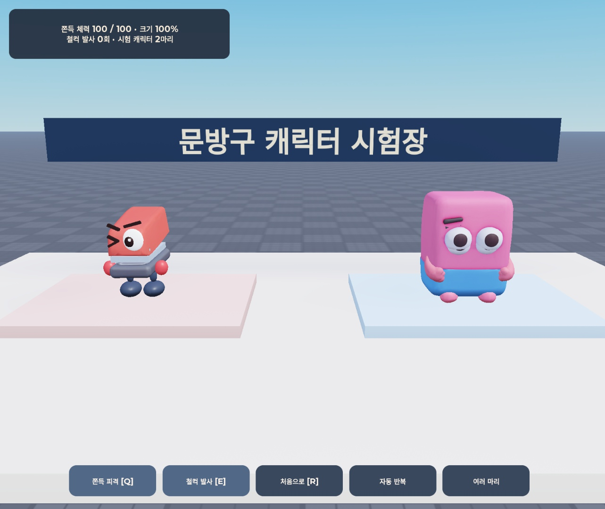
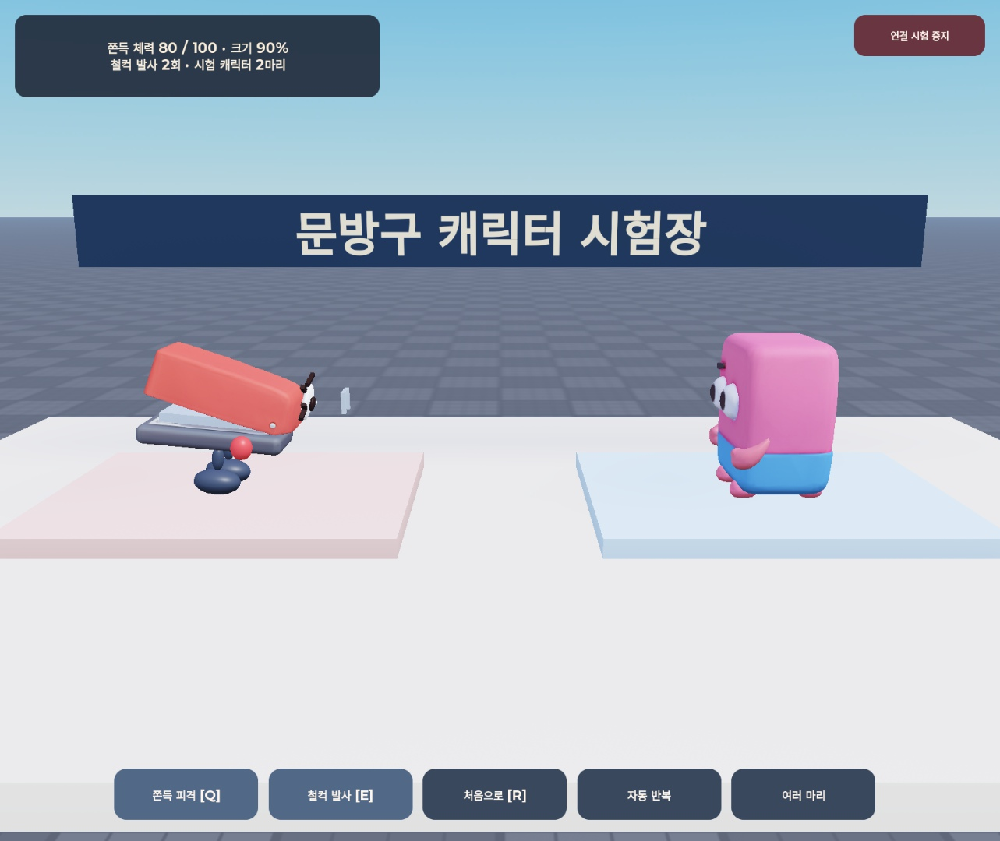
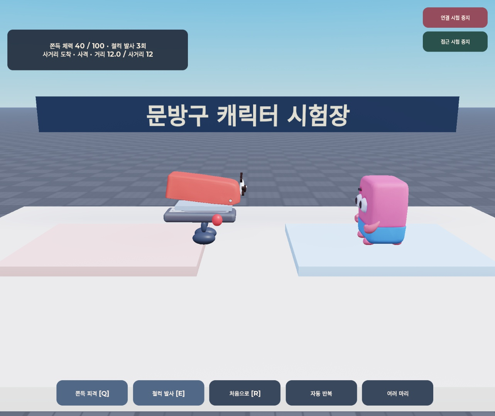

# 문방구 캐릭터 시험장

쫀득의 피격 축소와 철컥의 발사·놀람·반동을 실제 Roblox Studio에서 확인하는 시제품이다. 연결 시험은 발사체 도착 뒤 서버 피해와 피격 연출을 함께 재생한다. 접근 시험은 철컥이가 사거리까지 이동한 뒤 사격하는 흐름을 확인한다. 게임 기획과 최신 작업 기록은 [새 게임 기획서](../docs/NEW_GAME_DESIGN.md)의 14~16절에 있다.

## 작업 대상

- 현재 Studio 이름 `문방구 전쟁`, Place ID `123176209315432`, Universe ID `10777479934`. 최초에는 저장 전 Place1이었다.
- 현재 Studio ID `b5ca1279-b9be-4ff8-808a-60c4c8d2be53`. 재시작 시 목록에서 다시 확인한다.
- Workspace 식별 속성 `PrototypeProject = "StationeryCharacterLab"`.
- 기존 고물상 Place ID `77293997616106`은 도구 스크립트의 실행 거절 대상이다.

## 시험 방법

새 Studio에서 Play를 누르면 고정 카메라와 시험 버튼이 나타난다.

| 조작 | 동작 |
|---|---|
| 쫀득 피격 / Q | 체력 20 감소와 외형 축소 |
| 철컥 발사 / E | 발사 효과음·철심 효과·상부 동작·몸 반동·눈 확대 |
| 처음으로 / R | 체력과 표시 상태 복원 |
| 자동 반복 | 피격·발사·체력 소진 뒤 복원 반복 |
| 여러 마리 | 시험 캐릭터 17마리로 전환, 다시 누르면 2마리 |
| 접근 시험 / Y | 사거리까지 접근 → 정지 → 사격 반복. 다시 누르면 위치·체력까지 초기화하고 중지 |
| 연결 시험 / T | 서로 마주 보고 발사→철심 비행→서버 피해→쫀득 축소를 반복. 다시 누르면 중지 |

서버가 체력·발사·도착 시각의 피해를 확정하며 클라이언트가 시각 모델·철심·지우개 가루를 재생한다. 연결 시험은 정지한 시험 표적에 대한 예약 피해 방식이다. 두 런타임 스크립트는 Studio에서만 동작하며 접근 시험의 고정 직선 이동 외에 실제 PvP·경로 탐색·충돌 기반 명중·저장 시스템은 후속 구현이다. 초기화나 연결 시험 중지 시 날아가던 철심의 예약 피해는 취소된다. 자동 반복·연결 시험·접근 시험은 서로 번갈아 켜진다. 접근 속도 2.6스터드/초와 사거리 12는 동작 시험용 수치다.

## 파일과 Studio 경로

| 파일 | Studio 반영 대상 / 용도 |
|---|---|
| `src/ServerScriptService/CharacterLab.server.luau` | `ServerScriptService/CharacterLab` |
| `src/StarterPlayer/StarterPlayerScripts/CharacterLab.client.luau` | `StarterPlayer/StarterPlayerScripts/CharacterLab` |
| `tools/build-character-lab.luau` | 시험장·식별용 리모트/폴더·초기 속성 구성 |
| `tools/prepare-generated-characters.luau` | 생성 원본 보관·시험 복제본·Edit 미리보기 준비 |
| `tools/refine-character-faces.luau` | 철컥 표정·팔다리 보완과 기본 스폰 무늬 숨김 |
| `screenshots/` | 실제 데스크톱·휴대폰 가로 미리보기 화면 |

빌드 도구는 생성 원본이 준비된 새 시험 Studio에서 순서대로 실행한다. 생성 에셋의 자동 재다운로드·완전한 무인 복구는 검증하지 않았다.

## 검증과 저장

2026-11-18, Studio 1인 Play에서 피격 5회·사망 표시·초기화·발사·반동 복귀·눈 확대 복귀·서버 연타 제한·자동 반복·17마리 렌더를 확인했다. 후속 연결 시험에서 5발에 맞춘 체력 80·60·40·20·0, 자동 복원·재시험, 예약 피해 취소와 효과 정리를 확인했다. iPhone 17 Pro 가로 시뮬레이터에서 버튼 클릭·안전 영역·문구 표시를 확인했다. 추가 접근 시험은 범위 밖 발사 거절·도착 후 사격·초기화/중지 시 예약 피해 취소·자동 복원·17마리 모드·실제 버튼/Y키 조작을 1인 Play로 확인했다. PC 6초 평균 60.016 FPS·p95 18.103ms, 최종 로그 오류·경고 0. 신규 접근 버튼의 모바일 미리보기·실제 휴대폰 성능과 멀티플레이·세로 화면은 미검증이다.

Studio와 원문·바이트·체크섬이 일치한다. 체크섬은 `(h * 31 + byte) % 1000000007` 방식이다.

| 스크립트 | 바이트 | 체크섬 |
|---|---|---|
| 서버 CharacterLab | 5519 | 688815915 |
| 클라이언트 CharacterLab | 15409 | 474747455 |

최초 시험장은 사용자가 `문방구 전쟁`으로 클라우드에 저장한 것을 확인했다. **이번 접근 시험 변경도 사용자가 Ctrl+S로 저장해야 한다.** 소스와 캡처는 이 폴더에 보관한다. 생성 원본 모델은 새 Studio의 `ServerStorage/CharacterLabSources`, 동작용 모델은 `ReplicatedStorage/CharacterLabAssets`에 있다. 생성 모델 에셋 번호는 쫀득 `124308299115203`, 철컥 `139594764218049`다.

이전 스크립트 원문은 새 Studio의 `ServerStorage/CharacterLabScriptBackups/BeforeApproach_*`에 보관했다. 현재 Play는 종료한 Edit 상태다.

